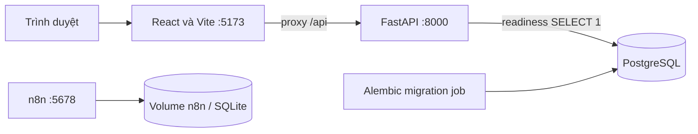

# Kiến trúc hệ thống

## Thành phần hiện tại

Backend có health API, CORS, SQLAlchemy và migration cho `users`, `departments`, `user_sessions`. API login/me/logout đã hoạt động. Model incident, evidence và idempotency nằm ở [incident data model](incident-data-model.md); migration và API nghiệp vụ sẽ được thêm theo [kế hoạch](KE_HOACH_CONG_VIEC.md). Alembic quản lý schema, API không tự tạo bảng lúc khởi động. [Principal/Policy và fixture](n1-identity-contract.md) dùng chung cho các mảng.

n8n dùng dữ liệu riêng. Workflow health check dùng để kiểm tra kết nối; workflow báo cáo và thông báo được phát triển ở các tuần sau.

## Cách các thành phần phối hợp

- Frontend hiển thị và nhập dữ liệu; backend là nơi kiểm tra quyền và quy tắc chuyển trạng thái.
- Backend ghi incident và outbox trong cùng giao dịch, cung cấp API nội bộ cho workflow.
- n8n điều phối qua API; không trực tiếp cập nhật bảng nghiệp vụ.
- PostgreSQL giữ dữ liệu nghiệp vụ. SQLite nội bộ của n8n chỉ giữ workflow/credentials/execution trong bản local starter.
- API nội bộ cần xác thực service credential, kiểm tra chữ ký webhook và chặn event gửi lại.

## Triển khai

Ba loại sự cố, quyền và SLA dùng cho demo được mô tả ở [yêu cầu nghiệp vụ](business-requirements.md); request/response nằm trong [API contract](api-contract.md). Mỗi user hiện có một role và tối đa một department. Nếu sau này cần nhiều department cho một user, hãy thêm migration thay vì sửa revision đã áp dụng.

Compose hiện phục vụ localhost. Môi trường public cần HTTPS, quản lý secrets, backup, giới hạn tài nguyên và cấu hình log phù hợp.
