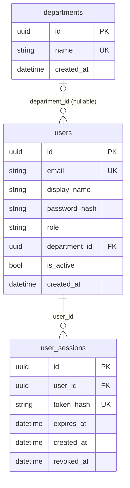

# N1 — Identity và phân quyền

## Mô hình dữ liệu

Migration `0001_identity` tạo `users` và `departments`; `154cfddf3634` thêm `user_sessions`. Mỗi user có một role và tối đa một department. Reporter và administrator có thể không thuộc department. Session chỉ lưu hash của token.

## Đăng nhập W3

`POST /api/v1/auth/login` kiểm tra mật khẩu bằng hash Argon2 đã lưu. Email không tồn tại, mật khẩu sai và tài khoản bị khóa đều trả cùng lỗi `401 invalid_credentials`; không tạo session. Với mỗi cặp email (viết thường)/IP kết nối trực tiếp, năm lần sai đầu trong 15 phút trả 401; các lần thử tiếp theo trả `429 rate_limited` cùng `Retry-After`. Đăng nhập đúng trước khi bị chặn sẽ xóa số lần sai của cặp đó. Backend trả `X-Request-ID` và lỗi theo dạng chung trong [API contract](api-contract.md).

API vẫn kiểm tra cú pháp email nhưng cho phép địa chỉ demo `@demo.invalid` do seed W2 sử dụng; domain này thường bị bộ kiểm tra email chặn theo mặc định.

Bộ đếm W3 nằm trong bộ nhớ của một process FastAPI để phục vụ bản demo Compose. Khởi động lại backend sẽ xóa bộ đếm; khi triển khai nhiều worker/instance cần chuyển sang kho dùng chung. Backend lấy IP từ kết nối trực tiếp, không tin header `X-Forwarded-For` do client tự gửi.

## Phiên bearer W4

Login trả token gốc một lần; bảng `user_sessions` chỉ lưu SHA-256 của token. Session hết hạn sau 8 giờ. Dependency bearer dùng chung kiểm tra token, thời hạn, `revoked_at` và `is_active` ở mỗi request. `/auth/me` trả thông tin user hiện tại; `/auth/logout` thu hồi đúng session đang dùng và trả 204. Token thiếu/sai/hết hạn/đã thu hồi hoặc của user bị khóa đều nhận `401 unauthenticated` theo error envelope chung và `WWW-Authenticate: Bearer`.

Hàm `lock_user` đặt `is_active=false` và thu hồi mọi session trong cùng transaction của bên gọi; thao tác quản trị W6 sẽ dùng hàm này khi khóa tài khoản. Nếu một công cụ khác sửa trực tiếp `is_active`, request dùng token cũ vẫn bị từ chối và backend thu hồi các session còn lại khi gặp request đó.

## Principal và Policy

`Principal`, `RolePolicy` và `IncidentPolicy` nằm trong `backend/app/auth/policy.py`. Role hoặc action lạ bị từ chối. `RolePolicy` kiểm tra quyền theo role cho endpoint chung; `IncidentPolicy.evaluate(principal, incident, action)` kiểm tra phạm vi từng incident cho comment, evidence và workflow. Comment và assignment cùng dùng interface này; router tạo incident vẫn dùng `RolePolicy` vì chưa có bản ghi để kiểm tra.

| Action trong RolePolicy | Reporter | Handler | Department manager | Administrator |
| --- | --- | --- | --- | --- |
| `report_incident` | Có, cho mình | Có, cho mình | Có, cho mình | Có, tạo cho mình |
| `view_assigned_incidents` | Không | Có, nếu được giao | Có, nếu thuộc bộ phận | Có, mọi incident |
| `manage_department` | Không | Không | Không | Có |
| `manage_users`, `manage_roles` | Không | Không | Không | Có |

`IncidentPolicy` cho mọi user thấy báo cáo do chính mình tạo; handler còn thấy incident đang được giao **và** thuộc bộ phận của mình, manager thấy incident thuộc bộ phận mình, administrator thấy mọi incident. Quyền sở hữu chỉ cho xem, comment công khai và evidence; quyền comment nội bộ/xử lý cần đúng phạm vi tác nghiệp. Nếu ở ngoài phạm vi xem, action trả `404 not_found` để che sự tồn tại bản ghi; nếu đã thấy incident nhưng không được làm action thì trả `403 forbidden`. Người không có quyền tác nghiệp không đọc được comment nội bộ (`404`). Assignment chỉ cho manager trong bộ phận hiện tại hoặc administrator, kể cả khi manager là người báo. Khi đổi assignment/bộ phận, policy dùng dữ liệu incident mới nên quyền tác nghiệp cũ mất hiệu lực.

Quyền theo từng thao tác và điều kiện trạng thái nằm trong [API contract](api-contract.md#quyền-theo-hành-động). [principals.json](fixtures/principals.json) có ID mẫu cho bốn role, bốn department và manager của `triage_queue`. File này dùng cho test/mock, không chứa mật khẩu hoặc token. `IncidentPolicy` xử lý phạm vi và quyền action; các service vẫn kiểm tra version, trạng thái và audit trước khi ghi.

## Quản trị tối thiểu W6

Nhánh `n1/w6-admin-management` bổ sung API `/api/v1/admin/*` cho administrator:

| API | Tác dụng |
| --- | --- |
| `GET /users` | Xem tài khoản theo `role`, `department_id`, `is_active`; phân trang bằng `limit` và cursor UUID. |
| `POST /users` | Tạo tài khoản và băm mật khẩu từ request; không trả mật khẩu hoặc hash. Handler/manager phải thuộc bộ phận có thật. |
| `PATCH /users/{id}` | Đổi role, bộ phận hoặc trạng thái hoạt động. Khóa user và đổi role/bộ phận thu hồi các session cũ. Không cho admin tự khóa hoặc tự bỏ role admin. |
| `GET/POST /departments` | Xem và thêm bộ phận, từ chối tên trùng. |
| `GET /rules`, `POST /rules/versions` | Xem và thêm phiên bản rule bất biến; kiểm tra category, condition, bộ phận đích và rule ID trùng. |

Các API này yêu cầu bearer token của `administrator`; tài khoản khác nhận 403. Tạo/sửa user, tạo bộ phận và rule version ghi `admin_audit_logs` cùng transaction với thay đổi. Audit có actor, action, target, request ID và snapshot trước/sau, nhưng không lưu mật khẩu hay token. Nếu transaction thất bại thì audit và thay đổi đều rollback.

Mật khẩu demo được nhập lúc gọi `POST /users` (ví dụ trong Swagger hoặc từ biến môi trường của máy), không ghi vào Git, URL, log hoặc tài liệu. Tạo user bằng API thay cho sửa DB bằng tay; dùng `PATCH /users/{id}` với `is_active=false` để khóa và thử token cũ trả 401. Admin vẫn dùng các API incident chung để xem và phân công sự cố ở mọi bộ phận; test W6 kiểm tra qua API thật.

Rule version mới được lưu với `is_active=false`: bộ đánh giá N3 hiện vẫn dùng `demo-v1` trong mã nguồn, chưa đọc rule mới từ DB. Vì vậy API W6 quản lý phiên bản để xem xét, **chưa kích hoạt quy tắc mới trong luồng phân loại**. Các API admin event lỗi/retry thuộc N5 và không nằm trong phần N1 W6.

## Tích hợp quyền W7

W7 dùng `IncidentPolicy` thống nhất tại các điểm đã có API:

- GET danh sách/chi tiết incident áp dụng cùng phạm vi owner, department và assignment; phần dữ liệu staff trong chi tiết cũng dùng `can_operate`, không lặp lại điều kiện role riêng.
- POST assign/acknowledge vẫn kiểm tra quyền trước version và trạng thái. API comment mới là adapter cho `CommentService` N4: GET lọc public/internal ngay trong truy vấn; POST kiểm tra quyền, expected_version và ghi comment/audit trong cùng transaction.
- Một staff tự tạo báo cáo vẫn xem được báo cáo và comment công khai; nếu không thuộc nhóm xử lý của báo cáo thì không được đọc hoặc viết comment nội bộ.
- Router file N2 dùng `IncidentPolicy` để kiểm tra phạm vi incident. `IncidentRoute` chuyển lỗi quyền từ service thành response 403/404 đúng contract; download ID file thuộc incident khác trả 404.

Test W7 gọi API thật trên PostgreSQL với reporter, handler, manager và administrator ở hai bộ phận. Ngoài phạm vi xem trả 404; đã được xem nhưng thiếu quyền thao tác trả 403. Sau khi chuyển bộ phận/handler, quyền cũ mất và quyền mới có hiệu lực; nội dung comment internal không lộ cho owner chỉ có quyền xem. Sau khi gộp N2 W6–W7 và N4 W7, chạy lại các test upload/list/download, supplement/history, transition, audit và cập nhật đồng thời trên PostgreSQL.

Chạy lại ma trận quyền W7 trên các endpoint N2 và N4 sau khi các PR liên quan được gộp.

## Ma trận kiểm thử âm tính & Seed dữ liệu lớn W8

W8 hoàn thiện việc rà soát ma trận quyền và kiểm thử âm tính trên tập dữ liệu seed lớn:
- **Seed lớn đa vai trò (`app/auth/seed_large.py`):** Tạo 8 phòng ban thực tế, hơn 35 tài khoản trải rộng 4 vai trò, kèm các phiên làm việc (active, expired, revoked, locked).
- **Test ma trận âm tính (`tests/test_n1_w8_negative_auth_matrix.py`):**
  - `401 Unauthorized`: Kiểm tra token thiếu, sai scheme, token giả mạo, session hết hạn, session bị thu hồi qua logout hoặc khóa tài khoản.
  - `404 Not Found`: Áp dụng kỹ thuật che giấu tài nguyên (masking) khi truy cập chéo giữa các reporter, chéo phòng ban giữa các handler/manager, hoặc handler chưa được giao sự cố.
  - `403 Forbidden`: Chặn các hành vi trong phạm vi xem nhưng vượt thẩm quyền (reporter tự đóng, handler đóng sự cố, reporter đăng comment nội bộ, tài khoản thường gọi admin API).
  - `429 Too Many Requests`: Rate limiter chống brute-force đăng nhập theo IP/email.

## Chuẩn hóa OpenAPI & Tương thích Frontend W9

W9 cố định hợp đồng giao tiếp giữa backend và frontend:
- **Error Envelope & Schema (`app/auth/schemas.py`):** Chuẩn hóa cấu trúc gói lỗi `ErrorEnvelope` và `ErrorResponse`, mã hóa các mã lỗi định danh (`invalid_credentials`, `unauthenticated`, `forbidden`, `not_found`, `rate_limited`).
- **OpenAPI 3.1.0 (`docs/openapi.json`):** Xuất toàn bộ 37 endpoint hệ thống với đầy đủ security scheme `BearerAuth`, request payload và response models.
- **Tích hợp API thật vào Frontend (`frontend/src/api/demo-client.ts`):** Chuyển đổi luồng login/logout và lấy thông tin người dùng sang API backend thực tế, hỗ trợ offline fallback mượt mà cho kịch bản demo trình diễn.
- **Kiểm thử hợp đồng frontend (`frontend/test-n1-w9-auth.ts`):** 16 bài kiểm thử TypeScript tự động đảm bảo frontend gọi đúng API backend và xử lý chính xác các mã lỗi 401/429.

## Kiểm toán bảo mật W10

W10 thực hiện rà soát và thắt chặt toàn diện an ninh hệ thống:
- **Bảo mật cơ sở dữ liệu:** Không lưu mật khẩu hoặc session token dạng plaintext (100% mật khẩu dùng bcrypt, session token dùng hàm băm an toàn SHA-256 `token_hash`).
- **Lọc dữ liệu nhạy cảm (`app/core/logging_security.py`):** Tự động che giấu Bearer token, password, credential trong log headers và request payloads.
- **Quét mã nguồn tự động:** Bộ test `test_n1_w10_security_audit.py` quét toàn bộ codebase đảm bảo không hardcode credentials, private keys hoặc API secrets trong Git.

## Runbook vận hành & Khôi phục thảm họa W11

W11 đóng gói tài liệu vận hành và công cụ sao lưu/khôi phục PostgreSQL:
- **Tài liệu hướng dẫn:** [docs/runbooks/identity-and-database.md](runbooks/identity-and-database.md) hướng dẫn dựng database sạch, chạy migration, seed tài khoản và quy trình khôi phục.
- **Công cụ tự động hóa:**
  - `backend/scripts/backup_db.py`: Sao lưu database với `pg_dump` nén gzip.
  - `backend/scripts/restore_db.py`: Khôi phục database sạch từ file backup với `psql`.
  - `backend/scripts/verify_restore.py`: Xác thực tính toàn vẹn dữ liệu và kiểm tra đăng nhập tự động cho cả 4 vai trò.
- **Kiểm thử tự động (`tests/test_n1_w11_backup_restore.py`):** Kiểm thử E2E toàn bộ chu trình backup -> drop/restore -> verify auth trên database trắng.

## Regression & Đóng băng mã nguồn W12

W12 hoàn tất các điều kiện nghiệm thu cuối cùng trước mốc 04/01/2027:
- **Bộ kiểm thử hồi quy tổng thể (`tests/test_n1_w12_regression.py`):**
  - **T07:** Cách ly dữ liệu giữa các reporter (bảo vệ bằng 404, không rò rỉ ID, comment hoặc bằng chứng).
  - **T08:** Cách ly phạm vi quản lý giữa các phòng ban (handler/manager không thể thao tác chéo phòng ban; administrator quản trị tập trung toàn trường có audit log).
  - **T09:** Thẩm quyền chuyển trạng thái vòng đời sự cố (nghiêm cấm reporter chuyển trạng thái, handler không được đóng/mở lại sự cố).
  - **Vòng đời Session:** Kiểm chứng thông suốt chu trình Đăng nhập -> Xác thực -> Thu hồi qua Logout -> Thu hồi tức thời khi Admin khóa tài khoản.
  - **Audit Trail:** Mọi thao tác quản trị tài khoản và phân quyền ghi vết không thể sửa xóa trong `admin_audit_logs`.
- **Đóng băng hợp đồng N1:** Toàn bộ model, migration, router auth/admin, runbook và test suite được đóng băng, test xanh 100%, sẵn sàng bàn giao cho các mảng N2–N7 và hội đồng bảo vệ.

