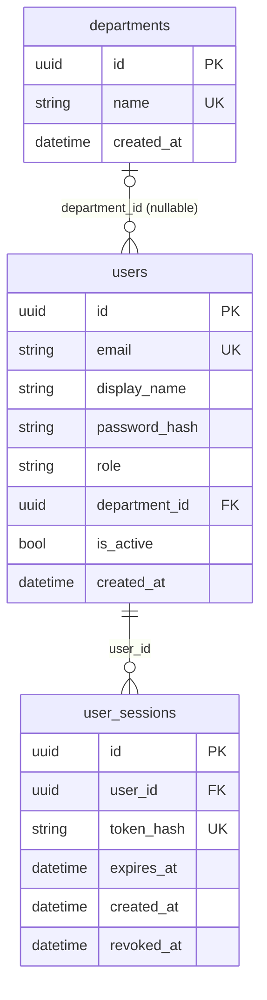

# N1 W1 — Identity và hợp đồng quyền

## Mô hình dữ liệu

`users` và `departments` thuộc migration `0001_identity`; `user_sessions` thuộc migration additive `154cfddf3634`. Mỗi user có một role và tối đa một department; reporter/administrator có thể không thuộc department. Session lưu hash token, không lưu token gốc.

## Principal và Policy dùng chung

`Principal(user_id: str, role: str, department_id: str | None)` nằm tại `backend/app/auth/policy.py`. `Policy.allows(principal, action) -> bool` mặc định từ chối role/action lạ. `RolePolicy` chỉ kiểm tra **quyền theo vai trò**; N2/N4/N7 phải kiểm tra thêm chủ sở hữu, department và assignment của từng incident trước khi trả dữ liệu hoặc cho thao tác.

| Action trong RolePolicy | Reporter | Handler | Department manager | Administrator |
| --- | --- | --- | --- | --- |
| `report_incident` | Có, cho mình | Có, cho mình | Có, cho mình | Không mặc định |
| `view_assigned_incidents` | Không | Có, nếu được giao | Có, nếu thuộc bộ phận | Không mặc định |
| `manage_department` | Không | Không | Không | Có |
| `manage_users`, `manage_roles` | Không | Không | Không | Có |

Ma trận nghiệp vụ đầy đủ ở [API contract](api-contract.md#quyền-theo-hành-động). Fixture ID ổn định cho bốn role và hai department ở [principals.json](fixtures/principals.json); không chứa tài khoản, mật khẩu hoặc token thật. Các mảng khác có thể nạp JSON này trực tiếp trong test/mock. Các action theo bản ghi (owner/department/assignment) sẽ được bổ sung ở W5 theo kế hoạch.
