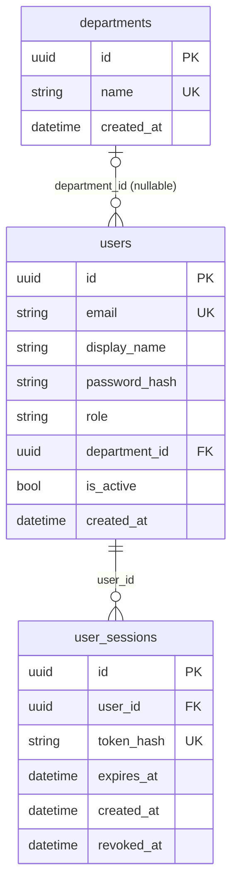

# N1 — Identity và phân quyền

## Mô hình dữ liệu

Migration `0001_identity` tạo `users` và `departments`; `154cfddf3634` thêm `user_sessions`. Mỗi user có một role và tối đa một department. Reporter và administrator có thể không thuộc department. Session chỉ lưu hash của token.

## Đăng nhập W3

`POST /api/v1/auth/login` kiểm tra mật khẩu bằng hash Argon2 đã lưu. Email không tồn tại, mật khẩu sai và tài khoản bị khóa đều trả cùng lỗi `401 invalid_credentials`; không tạo session. Với mỗi cặp email (viết thường)/IP kết nối trực tiếp, năm lần sai đầu trong 15 phút trả 401; các lần thử tiếp theo trả `429 rate_limited` cùng `Retry-After`. Đăng nhập đúng trước khi bị chặn sẽ xóa số lần sai của cặp đó. Backend trả `X-Request-ID` và lỗi theo dạng chung trong [API contract](api-contract.md).

API vẫn kiểm tra cú pháp email nhưng cho phép địa chỉ demo `@demo.invalid` do seed W2 sử dụng; domain này thường bị bộ kiểm tra email chặn theo mặc định.

Bộ đếm W3 nằm trong bộ nhớ của một process FastAPI để phục vụ bản demo Compose. Khởi động lại backend sẽ xóa bộ đếm; khi triển khai nhiều worker/instance cần chuyển sang kho dùng chung. Backend lấy IP từ kết nối trực tiếp, không tin header `X-Forwarded-For` do client tự gửi.

## Phiên bearer W4

Login trả token gốc một lần; bảng `user_sessions` chỉ lưu SHA-256 của token. Session hết hạn sau 8 giờ. Dependency bearer dùng chung kiểm tra token, thời hạn, `revoked_at` và `is_active` ở mỗi request. `/auth/me` trả thông tin user hiện tại; `/auth/logout` thu hồi đúng session đang dùng và trả 204. Token thiếu/sai/hết hạn/đã thu hồi hoặc của user bị khóa đều nhận `401 unauthenticated` theo error envelope chung và `WWW-Authenticate: Bearer`.

Hàm `lock_user` đặt `is_active=false` và thu hồi mọi session trong cùng transaction của bên gọi; thao tác quản trị W6 sẽ dùng hàm này khi khóa tài khoản. Nếu một công cụ khác sửa trực tiếp `is_active`, request dùng token cũ vẫn bị từ chối và backend thu hồi các session còn lại khi gặp request đó.

## Principal và Policy

`Principal`, `RolePolicy` và `IncidentPolicy` nằm trong `backend/app/auth/policy.py`. Role hoặc action lạ bị từ chối. `RolePolicy` kiểm tra quyền theo role cho endpoint chung; `IncidentPolicy.evaluate(principal, incident, action)` kiểm tra phạm vi từng incident cho comment, evidence và workflow. Comment và assignment cùng dùng interface này; router tạo incident vẫn dùng `RolePolicy` vì chưa có bản ghi để kiểm tra.

| Action trong RolePolicy | Reporter | Handler | Department manager | Administrator |
| --- | --- | --- | --- | --- |
| `report_incident` | Có, cho mình | Có, cho mình | Có, cho mình | Có, tạo cho mình |
| `view_assigned_incidents` | Không | Có, nếu được giao | Có, nếu thuộc bộ phận | Có, mọi incident |
| `manage_department` | Không | Không | Không | Có |
| `manage_users`, `manage_roles` | Không | Không | Không | Có |

`IncidentPolicy` cho mọi user thấy báo cáo do chính mình tạo; handler còn thấy incident đang được giao **và** thuộc bộ phận của mình, manager thấy incident thuộc bộ phận mình, administrator thấy mọi incident. Quyền sở hữu chỉ cho xem, comment công khai và evidence; quyền comment nội bộ/xử lý cần đúng phạm vi tác nghiệp. Nếu ở ngoài phạm vi xem, action trả `404 not_found` để che sự tồn tại bản ghi; nếu đã thấy incident nhưng không được làm action thì trả `403 forbidden`. Người không có quyền tác nghiệp không đọc được comment nội bộ (`404`). Assignment chỉ cho manager trong bộ phận hiện tại hoặc administrator, kể cả khi manager là người báo. Khi đổi assignment/bộ phận, policy dùng dữ liệu incident mới nên quyền tác nghiệp cũ mất hiệu lực.

Quyền theo từng thao tác và điều kiện trạng thái nằm trong [API contract](api-contract.md#quyền-theo-hành-động). [principals.json](fixtures/principals.json) có ID mẫu cho bốn role, bốn department và manager của `triage_queue`. File này dùng cho test/mock, không chứa mật khẩu hoặc token. `IncidentPolicy` xử lý phạm vi và quyền action; các service vẫn kiểm tra version, trạng thái và audit trước khi ghi.
