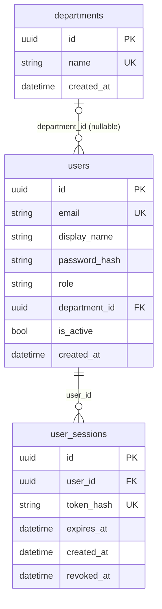

# N1 — Identity và phân quyền

## Mô hình dữ liệu

Migration `0001_identity` tạo `users` và `departments`; `154cfddf3634` thêm `user_sessions`. Mỗi user có một role và tối đa một department. Reporter và administrator có thể không thuộc department. Session chỉ lưu hash của token.

## Principal và Policy

`Principal` và `RolePolicy` nằm trong `backend/app/auth/policy.py`. Role hoặc action lạ bị từ chối. `RolePolicy` chỉ kiểm tra role; API incident/file còn phải kiểm tra owner, department và assignment của từng bản ghi.

| Action trong RolePolicy | Reporter | Handler | Department manager | Administrator |
| --- | --- | --- | --- | --- |
| `report_incident` | Có, cho mình | Có, cho mình | Có, cho mình | Có, tạo cho mình |
| `view_assigned_incidents` | Không | Có, nếu được giao | Có, nếu thuộc bộ phận | Có, mọi incident |
| `manage_department` | Không | Không | Không | Có |
| `manage_users`, `manage_roles` | Không | Không | Không | Có |

Quyền theo từng thao tác nằm trong [API contract](api-contract.md#quyền-theo-hành-động). [principals.json](fixtures/principals.json) có ID mẫu cho bốn role, bốn department và manager của `triage_queue`. File này dùng cho test/mock, không chứa mật khẩu hoặc token. Kiểm tra quyền theo từng incident được triển khai cùng các endpoint nghiệp vụ ở W5.
