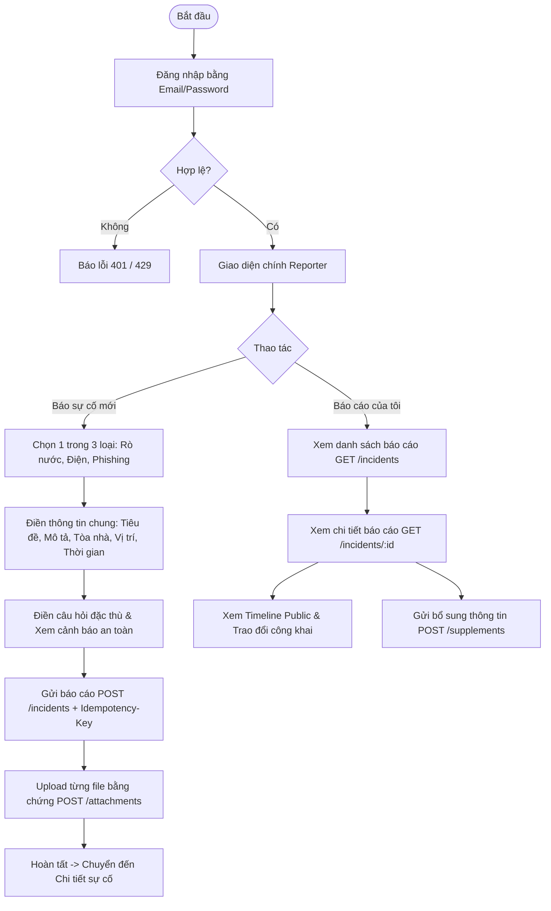

# Wireframe N6–N7

N6 phụ trách giao diện reporter; N7 phụ trách giao diện handler và manager.
Wireframe dùng [API contract](api-contract.md) và mock API để chạy khi backend
nghiệp vụ chưa có. Bearer token chỉ nằm trong bộ nhớ ứng dụng.

Ví dụ response khi version đã thay đổi:

```json
{
  "error": {
    "code": "version_conflict",
    "message": "Bản ghi đã thay đổi. Hãy tải lại trước khi tiếp tục.",
    "details": [{"field": "expected_version", "reason": "stale"}],
    "request_id": "9c23fa93-756a-45c7-805b-96d9094b908d"
  }
}
```

## N6 — Reporter

### Luồng chính



### Ba form báo cáo

| Loại sự cố | Câu hỏi bắt buộc | Câu hỏi tùy chọn | Cảnh báo khẩn cấp / Hướng dẫn an toàn |
| :--- | :--- | :--- | :--- |
| **Rò nước** (`water_leak`) | - `leak_amount`: ít (`small`), nhiều (`large`), không rõ (`unknown`)<br>- `near_electricity`: có (`yes`), không (`no`), không rõ (`unknown`) | - `slip_risk`: Có nguy cơ trượt ngã (boolean / null) | **Nếu gần điện:** *"Nếu đang có nguy hiểm tức thời, hãy rời khỏi khu vực và liên hệ đầu mối khẩn cấp của trường theo hướng dẫn chính thức. Gửi báo cáo trong ứng dụng không thay thế cuộc gọi ứng cứu."* |
| **Nguy hiểm điện** (`electrical_hazard`) | - `exposed_wire`: có dây hở (`yes`/`no`/`unknown`)<br>- `smoke_or_sparks`: có khói/tia lửa (`yes`/`no`/`unknown`) | - `equipment`: thiết bị liên quan (chuỗi tối đa 200 ký tự) | **Dấu hiệu nguy hiểm tức thời:** Cảnh báo nổi bật nền đỏ, yêu cầu giữ khoảng cách an toàn, không tự ý ngắt điện nếu không có chuyên môn. |
| **Phishing** (`phishing`) | - `interaction`: mức tương tác (`none`/`clicked_link`/`entered_information`/`unknown`)<br>- `channel`: kênh nhận (`email`/`message`/`other`) | - `sender_text`: địa chỉ người gửi/tên miền nghi vấn (tối đa 254 ký tự) | **Cảnh báo bảo mật:** *"Không nhập mật khẩu, mã OTP hoặc dữ liệu bí mật vào báo cáo; nếu đã nhập thông tin trên trang nghi giả mạo, hãy liên hệ IT/Security qua kênh chính thức."* |

#### Field chung
- `title`: Chuỗi từ 5 đến 120 ký tự (bắt buộc).
- `description`: Chuỗi từ 20 đến 2000 ký tự (bắt buộc).
- `building`: Chuỗi từ 1 đến 120 ký tự (bắt buộc).
- `location_detail`: Tùy chọn, tối đa 200 ký tự.
- `observed_at`: Tùy chọn, chuẩn ISO 8601 UTC, **không được ở tương lai**.
- `Idempotency-Key`: UUID tạo ở client, ngăn chặn gửi lặp khi mạng chập chờn.

### Trạng thái giao diện

| Trạng thái | Điều kiện kích hoạt | Biểu hiện trên giao diện | Hành động phục hồi |
| :--- | :--- | :--- | :--- |
| **Loading** | Đang gọi API lấy danh sách, gửi báo cáo hoặc tải file | Hiển thị Skeleton loader trên danh sách hoặc Spinner loading trên nút bấm (nút bị disabled) | Tự tắt khi có phản hồi hoặc timeout sau 10s |
| **Empty** | Danh sách sự cố của người báo rỗng (`items: []`) | Icon hộp trống, thông báo *"Bạn chưa có báo cáo sự cố nào"*, nút bấm chuyển sang tab *"Gửi báo cáo mới"* | Bấm nút tạo báo cáo |
| **Error 422 (Validation)** | Form thiếu trường bắt buộc, tiêu đề < 5 ký tự, file quá 10MB | Viền đỏ ô nhập liệu, dòng chữ đỏ mô tả lỗi ngay dưới field (inline error) và banner tổng hợp | Người dùng sửa lại ô nhập liệu và gửi lại |
| **Error 401 (Unauthenticated)**| Token hết hạn hoặc chưa đăng nhập | Toast cảnh báo *"Phiên đăng nhập đã hết hạn"*, tự động chuyển hướng về form đăng nhập | Đăng nhập lại để cấp token mới |
| **Error 409 (Conflict)** | Gửi bổ sung thông tin với `expected_version` bị cũ | Modal thông báo *"Sự cố đã được cập nhật bởi thao tác khác. Vui lòng làm mới dữ liệu"* kèm nút *"Tải lại dữ liệu"* | Bấm tải lại để lấy version mới nhất, form bổ sung giữ lại nội dung đang gõ |

### Wireframe reporter

```text
+------------------------------------------------------------------------------------+
| [USTH Campus Incident Management]              [Sinh viên: Lê Minh Tuấn] [Đăng xuất]|
+------------------------------------------------------------------------------------+
|  [Tab: Gửi báo cáo sự cố]   |   [Tab: Sự cố của tôi (3)]                           |
+------------------------------------------------------------------------------------+
|                                                                                    |
|  BÁO CÁO SỰ CỐ MỚI                                                                 |
|  +------------------------------------------------------------------------------+  |
|  | Bước 1: Chọn loại sự cố:                                                     |  |
|  |  (o) Rò rỉ nước (Water Leak)   ( ) Nguy hiểm điện   ( ) Email lừa đảo/Phishing|  |
|  +------------------------------------------------------------------------------+  |
|                                                                                    |
|  [!] CẢNH BÁO AN TOÀN:                                                              |
|  Nếu đang có nguy hiểm tức thời, hãy rời khỏi khu vực và liên hệ khẩn cấp!         |
|                                                                                    |
|  Tiêu đề (*):        [ Rò nước ở hành lang tầng 2                       ] (5-120 ký tự)|
|  Tòa nhà (*):        [ Tòa A                                            ]          |
|  Vị trí chi tiết:    [ Tầng 2, gần phòng học 205                        ]          |
|  Thời điểm quan sát: [ 2026-10-15T09:20                                 ] (Không tương lai)|
|  Mô tả chi tiết (*): [ Nước chảy nhiều từ trần nhà, sàn ướt và trơn trượt.....  ] (20-2000)|
|                                                                                    |
|  Câu hỏi đặc thù:                                                                  |
|  - Mức độ rò nước:   ( ) Ít   (o) Nhiều   ( ) Không rõ                             |
|  - Gần nguồn điện?   ( ) Có   (o) Không   ( ) Không rõ                             |
|  - [x] Có nguy cơ gây trượt ngã                                                    |
|                                                                                    |
|  Đính kèm bằng chứng (PDF, PNG, JPG <= 10MB):                                      |
|  [ + Chọn tệp đính kèm ]                                                           |
|  - [anh_hien_truong.jpg] (1.2 MB) [Sẵn sàng tải lên] [Xóa]                         |
|                                                                                    |
|  [ Gửi báo cáo sự cố ] (Idempotency Protected)                                     |
+------------------------------------------------------------------------------------+
```

## N7 — Handler và manager

### Luồng chính

```mermaid
flowchart TD
    StaffLogin[Đăng nhập vai trò Handler / Manager] --> QueueView[Hàng đợi sự cố - Queue View]

    %% Bộ lọc & SLA
    QueueView --> FilterQueue[Lọc: Department, Status, Priority, Triage, Overdue SLA]
    FilterQueue --> SelectIncident[Chọn sự cố để xem chi tiết]

    %% Chi tiết & Thao tác
    SelectIncident --> DetailView[Chi tiết sự cố + Timeline + Trao đổi]

    DetailView --> ActionBranch{Quyền & Hành động}

    %% Manager Triage
    ActionBranch -- Manager: Triage Required --> TriageAction[Triage: Phân loại bộ phận + Priority + Lý do]

    %% Manager Phân công
    ActionBranch -- Manager: Phân công --> AssignAction[Assign: Chọn Handler + Lý do]

    %% Handler Tiếp nhận (Acknowledge)
    ActionBranch -- Handler: Nhận sự cố --> AckAction[Acknowledge: assigned -> in_progress (Dừng SLA)]

    %% Manager Đổi Priority
    ActionBranch -- Manager: Đổi ưu tiên --> PriorityAction[Change Priority: P1/P2/P3 + Lý do (Tính lại SLA)]

    %% Handler / Manager Chuyển trạng thái
    ActionBranch -- Xử lý xong --> ResolveAction[Resolve: Nhập nội dung giải quyết resolution]
    ActionBranch -- Quản lý đóng --> CloseAction[Close: Xác nhận kết quả]
    ActionBranch -- Quản lý mở lại --> ReopenAction[Reopen: in_progress + Lý do]

    %% Manager Disposition
    ActionBranch -- Trùng / Không hợp lệ --> DispAction[Disposition: duplicate / invalid + Lý do]

    %% Ghi chú
    ActionBranch -- Bình luận --> AddNote[Thêm Public Comment hoặc Internal Note]
```

### SLA và triage queue

#### SLA tiếp nhận
- **P1:** Deadline tiếp nhận là **15 phút** kể từ `reported_at`.
- **P2:** Deadline tiếp nhận là **2 giờ** kể từ `reported_at`.
- **P3:** Deadline tiếp nhận là **8 giờ** kể từ `reported_at`.
- SLA dừng khi incident chuyển `assigned → in_progress`; `acknowledged_at` được ghi một lần.
- Nếu đã qua deadline mà `acknowledged_at = null`, hiển thị nhãn “Quá hạn” và thời gian trễ.

#### Triage queue (`triage_required = true`)
- Khi sự cố không khớp rule tự động hoặc câu trả lời có "không rõ", hệ thống gán vào `triage_queue`.
- Sự cố giữ `status = reported`, `priority = null`.
- Manager của hàng đợi Triage có quyền xem và thực hiện chuyển sang bộ phận phụ trách (`Cơ sở vật chất`, `Điện và an toàn`, `IT/Security`) và gán priority phù hợp kèm lý do bắt buộc.

### Xử lý 409 khi hai người cùng thao tác

Mỗi thao tác ghi gửi `expected_version`. Nếu A và B cùng mở version 1, A lưu
trước thì incident lên version 2. B gửi version 1 sẽ nhận `409 version_conflict`.
Giao diện giữ dữ liệu B đang nhập, báo “Bản ghi đã thay đổi” và cho tải lại
incident trước khi gửi tiếp.

### Wireframe hàng đợi và chi tiết

```text
+------------------------------------------------------------------------------------+
| [USTH Campus Incident Management]              [Manager: Hoàng Đức (CSVC)] [Thoát]  |
+------------------------------------------------------------------------------------+
| BẢNG ĐIỀU KHIỂN HÀNG ĐỢI SỰ CỐ (INCIDENT QUEUE)                                     |
|                                                                                    |
| [Bộ lọc nhanh]: [Tất cả (12)]  [Cần Triage (2)]  [Quá hạn SLA (3)]  [Đang xử lý (4)]|
|                                                                                    |
| Bộ lọc: [Bộ phận: Cơ sở vật chất v] [Ưu tiên: Tất cả v] [Trạng thái: Tất cả v]    |
+------------------------------------------------------------------------------------+
| MÃ / TIÊU ĐỀ           | LOẠI      | ƯU TIÊN | TRẠNG THÁI   | SLA TIẾP NHẬN | THAO TÁC |
|-----------------------+-----------+---------+--------------+---------------+----------|
| #2ee24 Rò nước tầng 2  | Rò nước   | [P1]    | Assigned     | [!] QUÁ HẠN   | [Xem]    |
| #4ab12 Chập ổ cắm      | Điện      | [P1]    | In Progress  | Đã nhận (5p)  | [Xem]    |
| #99c10 Nghi email lừa  | Phishing  | [P3]    | Reported     | Còn 6 giờ     | [Xem]    |
| #11d33 Báo cáo không rõ| Rò nước   | [Chờ]   | Triage Req   | Cần review 15p| [Triage] |
+------------------------------------------------------------------------------------+

CHI TIẾT SỰ CỐ #2ee24992 (Version: 1)
+----------------------------------------------------+-------------------------------+
| THÔNG TIN CHÍNH                                    | LỊCH SỬ & TRAO ĐỔI            |
| Tiêu đề: Rò nước ở hành lang tầng 2 phòng 205      | [Tab: Lịch sử] [Tab: Trao đổi]|
| Loại: Rò nước (Water Leak) | Ưu tiên: P1           |                               |
| Bộ phận: Cơ sở vật chất   | Người xử lý: [Chưa có] | 09:30 - Báo cáo được tạo      |
| SLA: Quá hạn tiếp nhận 25 phút                     | 09:31 - Rule demo-v1 gán P1   |
|                                                    | (Lý do: Nước gần nguồn điện)  |
| [CÂU HỎI ĐẶC THÙ]                                  | 09:35 - Phân công: CSVC       |
| - Mức rò: Nhiều                                    |                               |
| - Gần điện: Có (Gắn cờ an toàn)                   | GHI CHÚ NỘI BỘ (INTERNAL):    |
|                                                    | [Internal] Cần mang bao cát   |
| [BẰNG CHỨNG ĐÍNH KÈM]                              | và ngắt cầu dao tầng 2.       |
| - evidence_water.jpg (Tải xuống)                   |                               |
|                                                    | [Thêm ghi chú nội bộ]         |
| [HÀNH ĐỘNG]:                                       | [Thêm bình luận công khai]    |
| [Tiếp nhận (Ack)] [Phân công] [Đổi ưu tiên] [Giải quyết] [Đóng/Mở lại] [Simulate 409]|
+----------------------------------------------------+-------------------------------+
```

## Mock API

Các endpoint dùng trong luồng giao diện; request/response chi tiết xem [API contract](api-contract.md):

- `POST /api/v1/auth/login`, `GET /api/v1/auth/me`, `POST /api/v1/auth/logout`
- `GET /api/v1/incidents` (phân quyền dữ liệu theo role, cursor pagination)
- `POST /api/v1/incidents` (tạo incident, Idempotency-Key 24h)
- `GET /api/v1/incidents/:id`
- `POST /api/v1/incidents/:id/supplements` (bổ sung thông tin, check `expected_version`)
- `GET /api/v1/incidents/:id/history` (lọc public cho reporter, full cho staff)
- `GET /api/v1/incidents/:id/comments` & `POST /api/v1/incidents/:id/comments` (phân biệt public/internal)
- `POST /api/v1/incidents/:id/attachments` (upload từng file riêng biệt)
- `POST /api/v1/incidents/:id/assign` (phân công handler / department)
- `POST /api/v1/incidents/:id/acknowledge` (tiếp nhận sự cố)
- `POST /api/v1/incidents/:id/priority` (đổi priority, tính lại SLA)
- `POST /api/v1/incidents/:id/transitions` (chuyển trạng thái)
- `POST /api/v1/incidents/:id/disposition` (duplicate/invalid)
